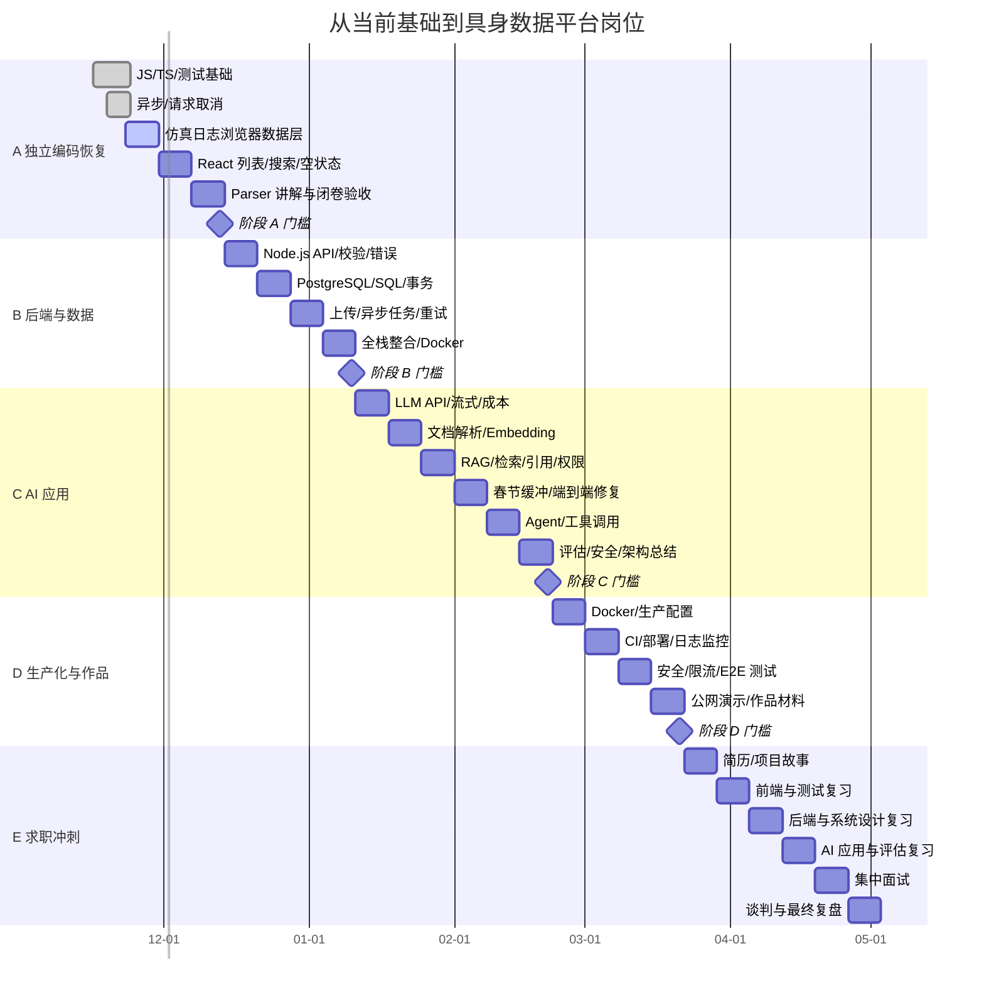

# 能力时间线：从当前基础到具身数据平台岗位

> 更新时间：2026-11-24
> 最终目标：杭州具身智能 / 机器人数据可视化与数据平台工程师，固定月薪最低 18k，冲刺 20–25k+
> 第二目标：AI 应用全栈 / 智能体应用工程师
> 用途：按时间点查看“需要会什么、现在会什么、下一步缺什么、怎样算通过”

---

## 一、状态图例

| 标记 | 含义 | 判断标准 |
|---|---|---|
| `[已掌握]` | 当前已验证 | 能解释、能独立完成、有测试或示例 |
| `[部分掌握]` | 能跟做或局部独立 | 能理解，但换场景或从空白开始仍需提示 |
| `[未掌握]` | 尚未形成能力 | 不能独立解释和实现 |
| `[未开始]` | 尚未进入学习 | 没有系统练习 |

阶段状态：

- `DONE`：阶段门槛已通过；
- `CURRENT`：当前正在执行；
- `NEXT`：下一阶段；
- `PLANNED`：尚未开始。

---

## 二、最终目标倒推

目标岗位需要同时具备四类能力：

```text
具身数据可视化岗位
├── 前端交付
│   ├── React + TypeScript
│   ├── HTML / CSS / DOM / 浏览器
│   ├── 路由 / 数据请求 / 缓存
│   ├── 响应式 / 可访问性
│   ├── 复杂状态与数据流
│   ├── 渲染与状态性能
│   ├── Vite / 类型检查 / Lint
│   └── 单元 / 组件 / E2E 测试
├── 具身数据可视化
│   ├── ROS / MCAP / rosbag
│   ├── 坐标系与时间同步
│   ├── 回放与实时流
│   ├── Three.js / WebGL / 图表
│   └── 大数据采样与渲染性能
├── 数据平台工程
│   ├── Node.js API
│   ├── PostgreSQL / SQL
│   ├── 文件与异步任务
│   ├── 权限与安全
│   └── Docker / CI / 监控
└── AI 应用能力
    ├── LLM API 与流式输出
    ├── RAG / 检索 / 引用
    ├── 工具调用 / Agent
    ├── 评估 / 成本 / 延迟
    └── Prompt Injection 与数据权限
```

当前工作接触过 Foxglove、仿真数据和 Parser，但“接触过”不等于“可独立讲解和实现”。该领域能力需要通过后续项目和口述验收确认。

---

## 三、24 周能力时间线

绿色/已完成状态使用 `done`，当前任务使用 `active`，未来任务保持默认状态。



说明：日历已进入原计划第 2 周，但实际仍在完成阶段 A 的仿真日志浏览器。当前应以能力门槛为准，不用日历进度掩盖未完成能力。

---

## 四、当前快照

> 截止：2026-11-24

| 项目 | 当前状态 |
|---|---|
| 当前阶段 | A：独立编码恢复 |
| 当前任务 | 个人仿真日志浏览器，先做数据契约、校验与搜索 |
| 最近完成 | 第 1–3 天：有效点统计、事件循环/请求取消、TypeScript 数据建模与测试 |
| 已验证代码 | 14 个测试通过；请求/取消演示通过；五种数组方法通过 |
| 最大缺口 | React 真实集成、安全 JSON 解析、后端/数据库、具身可视化和 AI 应用 |
| 下一验收点 | 定义 `LogLevel`、`SimulationLog`、`SimulationLogFile` |
| 阶段 A 截止 | 2026-12-13；未通过则顺延，不进入后端与 AI |

---

## 五、每个时间点必须掌握什么

### 阶段 A：独立编码恢复

| 时间 | 必须掌握 | 当前状态 | 验收产物 |
|---|---|---|---|
| 11/16–11/23 | 值/类型、函数、条件、循环、数组方法、TypeScript 对象与联合类型、测试基础 | `[已掌握基础]` | 有效点函数、数组方法练习、7 个测试 |
| 11/19–11/23 | 同步/异步、事件循环、`fetch`、HTTP、`AbortController`、loading/error | `[部分掌握]` | 请求与取消演示、hook 代码 |
| 11/23–11/30 | 合成 JSON 契约、`unknown` 校验、搜索、React 列表/空状态 | `[进行中]` | 仿真日志浏览器 |
| 12/01–12/06 | HTML/CSS/DOM、React 组件、Props、状态提升、表单、响应式、可访问性、组件测试 | `[未掌握]` | 可交互日志页面与组件测试 |
| 12/07–12/13 | Parser 业务链路、代码阅读、Bug 定位、Git 回滚、闭卷验收 | `[部分掌握]` | Parser 讲解与阶段 A 测验 |

阶段 A 通过标准：

- 能从空白完成基础函数并设计测试；
- 能解释并实现请求竞态与取消；
- 能解释 React 数据从读取到展示的流程；
- 能脱稿讲清一个 Parser；
- 能定位一个小 Bug，并说明测试证据。

### 阶段 B：后端与数据平台

| 时间 | 必须掌握 | 当前状态 | 验收产物 |
|---|---|---|---|
| 12/14–12/20 | HTTP/REST、Node.js + TypeScript、Zod、错误格式、日志、密钥 | `[未开始]` | 任务 CRUD API |
| 12/21–12/27 | PostgreSQL、表关系、SQL、索引、事务、Prisma | `[未开始]` | 数据表与分页查询 |
| 12/28–01/03 | 上传、异步任务、状态机、幂等、重试 | `[未开始]` | 日志上传与任务队列 |
| 01/04–01/10 | 前后端整合、鉴权、数据隔离、Docker Compose | `[未开始]` | 可运行全栈平台 |

阶段 B 通过标准：

- 能设计 API 和错误响应；
- 能写基本 SQL 并解释索引；
- 能处理上传失败、重试和重复请求；
- 能从浏览器请求追踪到数据库；
- 能用 Docker 启动环境。

### 阶段 C：AI 应用

| 时间 | 必须掌握 | 当前状态 | 验收产物 |
|---|---|---|---|
| 01/11–01/17 | LLM API、流式输出、Prompt、结构化输出、Token/费用 | `[未开始]` | 流式 AI 对话 |
| 01/18–01/24 | 文档解析、切分、Embedding、向量检索 | `[未开始]` | 文档索引任务 |
| 01/25–01/31 | RAG、Top K、引用、无资料拒答、权限过滤 | `[未开始]` | 带引用问答 |
| 02/01–02/07 | 端到端修复、20 条评估集 | `[未开始]` | 可运行 RAG 基线 |
| 02/08–02/14 | 工具调用、Agent、超时、幂等、用户确认、Prompt Injection | `[未开始]` | 查询/比较工具 |
| 02/15–02/21 | 检索/引用/有据性评估、延迟、成本、失败分类 | `[未开始]` | 30 条评估与架构图 |

阶段 C 通过标准：

- 能解释完整 RAG 流程；
- 能判断错误来自检索、生成、权限还是数据；
- 能处理无资料、超时、模型失败和工具失败；
- 能证明权限过滤有效；
- 能展示评估、延迟和费用。

### 阶段 D：生产化与作品

| 时间 | 必须掌握 | 当前状态 | 验收产物 |
|---|---|---|---|
| 02/22–02/28 | 前后端容器化、环境配置、密钥管理 | `[未开始]` | Docker 一键启动 |
| 03/01–03/07 | CI、类型检查、单元测试、部署、日志与监控 | `[未开始]` | 自动化部署 |
| 03/08–03/14 | 上传安全、XSS、SQL 注入、越权、限流、E2E | `[未开始]` | 安全加固与 Playwright |
| 03/15–03/21 | README、架构图、演示视频、性能/成本数据、STAR 讲解 | `[未开始]` | 公网作品 |

阶段 D 通过标准：

- 他人能按 README 启动；
- 主流程有自动化测试；
- 演示环境可访问；
- 能解释日志、权限、延迟和费用；
- 能进行 10 分钟项目讲解。

### 阶段 E：求职冲刺

| 时间 | 必须掌握 | 当前状态 | 验收产物 |
|---|---|---|---|
| 03/22–03/28 | 简历、30 秒/2 分钟/10 分钟项目表达 | `[未开始]` | 简历与项目故事 |
| 03/29–04/04 | JS/TS/React/网络/测试面试题 | `[未开始]` | 2 次前端模拟面试 |
| 04/05–04/11 | Node.js/SQL/API/鉴权/系统设计 | `[未开始]` | 2 次后端模拟面试 |
| 04/12–04/18 | RAG/Agent/评估/安全/成本 | `[未开始]` | 2 次 AI 系统设计 |
| 04/19–04/25 | 集中面试与复盘 | `[未开始]` | 面试记录 |
| 04/26–05/02 | offer 对比、薪资谈判、团队与岗位判断 | `[未开始]` | 目标 offer |

---

## 六、能力覆盖矩阵

`●` 重点训练，`○` 基础接触，`—` 不是该阶段重点。

| 能力 | A | B | C | D | E | 当前状态 |
|---|---:|---:|---:|---:|---:|---|
| JavaScript / TypeScript | ● | ○ | ○ | ○ | ● | `[已掌握基础/部分掌握]` |
| HTML / CSS / DOM / 可访问性 | ● | ○ | — | ○ | ● | `[部分经历/未系统验证]` |
| React 组件与状态 | ● | ○ | ○ | ● | ● | `[部分掌握]` |
| React 路由 / 数据请求 / 缓存 | ○ | ● | ● | ● | ● | `[未开始]` |
| 数据建模与 JSON 校验 | ● | ○ | ○ | ○ | ● | `[部分掌握]` |
| 测试设计 | ● | ● | ● | ● | ● | `[部分掌握]` |
| HTTP / API | ○ | ● | ● | ● | ● | `[部分掌握]` |
| PostgreSQL / SQL | — | ● | ○ | ○ | ● | `[未开始]` |
| 异步任务 / 上传 | ○ | ● | ● | ● | ● | `[未开始]` |
| LLM / RAG | — | — | ● | ○ | ● | `[未开始]` |
| Agent / 工具调用 | — | — | ● | ○ | ● | `[未开始]` |
| 权限 / 安全 | ○ | ● | ● | ● | ● | `[未开始]` |
| Docker / CI / 监控 | — | ● | ○ | ● | ● | `[未开始]` |
| 具身数据可视化 | ● | ○ | ○ | ● | ● | `[部分经历/未验证]` |
| SVG / Canvas / D3 / 图表库 | — | — | ○ | ● | ● | `[未开始]` |
| Three.js / WebGL | — | — | — | ● | ● | `[未掌握]` |
| 简历 / 面试 | — | — | — | ○ | ● | `[未开始]` |

---

## 七、能力清单与掌握状态

### 已掌握

- `const/let` 重新赋值规则；
- `for...of`、`reduce`、`forEach`、`map`、`filter`；
- 普通循环与 `setTimeout` 的同步/异步区别；
- 宏任务、微任务、`async/await` 基础顺序；
- TypeScript 对象类型、字符串联合类型、`readonly` 输入；
- `catch (error)` 的 `unknown` 与错误归一化；
- `fetch`、`response.ok`、JSON 解析和 `AbortController` 基础；
- loading 在成功、错误和取消路径中的处理；
- Arrange、Act、Assert；
- `assert.equal` 与 `assert.deepEqual`；
- 从规则推导等价类和边界测试；
- Git 提交、拉取、推送和双机交接。

### 部分掌握

- JavaScript 闭包、作用域、对象内部机制和模块系统；
- TypeScript 泛型、复杂类型收窄和运行时校验；
- HTML 语义、CSS 布局、响应式、可访问性和浏览器调试；
- React `useState`、`useEffect`、组件拆分和性能；
- React Router、数据请求库、缓存、错误边界和表单交互；
- 请求逻辑在真实 React 组件中的挂载测试；
- Vite、TypeScript 配置、ESLint/格式化和构建流程；
- 数据搜索、筛选和大数据性能；
- Parser 模块的完整业务链路讲解；
- Foxglove、仿真日志和具身数据的系统表达；
- 测试 mock、异步测试和组件测试。

### 未掌握

- Node.js REST API 和鉴权；
- PostgreSQL、SQL、事务、索引和 ORM；
- 文件上传、队列、异步任务和重试；
- Docker、CI、部署、日志、监控；
- LLM API、流式输出、RAG、Agent 和评估；
- Prompt Injection、权限隔离和模型成本控制；
- Three.js / WebGL 场景生命周期；
- 坐标变换、帧同步、时间轴回放；
- 点云/轨迹/相机等多模态可视化；
- SVG、Canvas 和 D3/图表库；
- Three.js 场景、Camera、Renderer、Controls 与资源释放；
- WebGL 基础、BufferGeometry、InstancedMesh 和 LOD；
- 实时 WebSocket/WebRTC 数据流；
- 大数据采样、LOD、InstancedMesh 和渲染性能；
- 简历、项目表达和模拟面试。

---

## 八、容易漏掉的具身数据可视化能力

以下能力直接对应目标岗位 JD，不能只靠完成通用 AI 全栈项目自然获得：

### 数据格式与机器人系统

- [ ] ROS / ROS2 topic、message、frame 基础；
- [ ] rosbag 与 MCAP 的结构差异；
- [ ] 传感器数据、相机、点云、轨迹和状态数据；
- [ ] 坐标系、TF、世界坐标与自车坐标转换；
- [ ] 时间戳、时钟同步、回放与实时流区别。

### 前端平台

- [ ] HTML 语义化结构与表单；
- [ ] CSS 布局、响应式和主题；
- [ ] DOM、事件、浏览器存储和 DevTools；
- [ ] 键盘操作、焦点管理和基础可访问性；
- [ ] Vite、TypeScript 配置、ESLint 和构建流程；
- [ ] React Router、数据请求缓存和错误边界。

### 可视化与交互

- [ ] 2D 图表、时间轴和多视图同步；
- [ ] SVG、Canvas 和 D3/图表库；
- [ ] Three.js 场景、Camera、Renderer、Controls 生命周期；
- [ ] 点、线、网格、包围盒和相机画面；
- [ ] 拾取、高亮、过滤和标注；
- [ ] 轨迹回放、暂停、倍速、拖动和跨视图同步。

### 性能与数据规模

- [ ] 数据采样、分页和虚拟列表；
- [ ] BufferGeometry 与 InstancedMesh；
- [ ] 点云降采样、LOD 和帧率控制；
- [ ] Web Worker 处理大文件；
- [ ] WebSocket/WebRTC 增量更新；
- [ ] 内存、GPU 资源释放和泄漏排查。

### 作品化落点

- 在阶段 A 通过后，用周末完成一个不占固定周次的具身数据作品；
- 首选 Foxglove 扩展面板或迷你回放查看器；
- 使用公开 LeRobot 数据集或自造合成数据；
- 不依赖公司源码和真实业务数据。

---

## 九、阶段自检入口

只有同时满足四项，才提升能力等级：

- [ ] 能脱离 AI 和文档解释；
- [ ] 能从空白文件实现；
- [ ] 能自己设计测试并运行通过；
- [ ] 能换一个场景迁移使用。

### 阶段 A 自检

- [ ] 基础函数与测试；
- [ ] 事件循环与请求取消；
- [ ] JSON 契约与搜索；
- [ ] React 列表、搜索与空状态；
- [ ] Parser 脱稿讲解；
- [ ] 闭卷定位一个小 Bug。

### 阶段 B 自检

- [ ] 新增 API；
- [ ] 表设计与 SQL；
- [ ] 上传、任务状态、失败重试；
- [ ] 权限与数据隔离；
- [ ] Docker 启动全栈。

### 阶段 C 自检

- [ ] 流式 LLM 调用；
- [ ] 文档切分、Embedding 和检索；
- [ ] 引用与无资料拒答；
- [ ] Agent 工具权限与幂等；
- [ ] 评估、延迟、成本和错误分类。

### 阶段 D 自检

- [ ] CI 和自动化测试；
- [ ] 公网部署；
- [ ] 日志、错误和监控；
- [ ] 安全加固；
- [ ] 10 分钟项目讲解。

### 阶段 E 自检

- [ ] 所有简历内容可解释；
- [ ] 前端、后端、AI 系统设计各完成模拟面试；
- [ ] 岗位确认不是外包或驻场；
- [ ] 获得或接近目标薪资 offer。

---

## 十、维护规则

- 本文档是唯一的能力时间线与总览；
- 详细知识写入 `复习文档.md`；
- 错误习惯与思维模式写入 `能力问题分析.md`；
- 只有出现真实证据才更新 `[未掌握] → [部分掌握] → [已掌握]`；
- 每周五闭卷自检后更新；
- 每次阶段验收通过后再更新阶段状态和日期；
- 如果实际进度落后于日历，以阶段门槛为准，不跳过未掌握能力。
